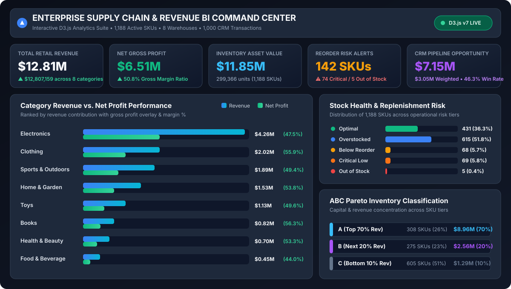
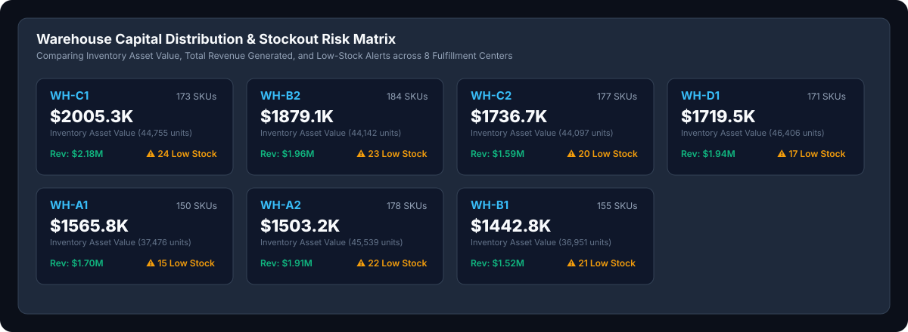
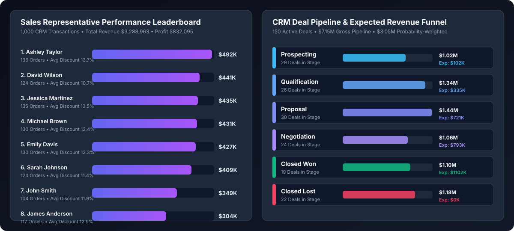

[](https://github.com/INNOCENT256-UG)

🔗 **[GitHub Profile](https://github.com/INNOCENT256-UG)** | 📊 **[Portfolio Repositories](https://github.com/INNOCENT256-UG?tab=repositories)**


---

# 🌐 Enterprise Supply Chain, Inventory & CRM Revenue BI Command Center

> **Executive Summary:** An end-to-end Business Intelligence and Decision-Support system that transforms **2,638+ raw operational records** across **1,188 retail inventory SKUs**, **1,000 B2B sales transactions**, **250 enterprise accounts**, and **150 sales pipeline leads** into an interactive **D3.js v7 Command Center** backed by an automated **Python ETL pipeline**.



---

## 🎯 Business Problem & Strategic Objectives

Modern retail and B2B operations suffer from two simultaneous capital inefficiencies:
1. **Stockout Revenue Leakage:** High-velocity Class-A SKUs fall below safety stock levels without automated procurement triggers, causing lost sales.
2. **Dead Working Capital:** Slow-moving SKUs accumulate across fulfillment centers (`WH-A1` through `WH-D2`), locking up millions in liquidity.

### How This BI Solution Solves It
- **ABC Pareto Revenue Classification:** Automatically segments 1,188 SKUs into **Class A (Top 70% Revenue)**, **Class B (Next 20%)**, and **Class C (Bottom 10%)** to prioritize working capital.
- **5-Tier Stock Health Risk Engine:** Flags every SKU as *Out of Stock*, *Critical Low ($\le 50\%$ Reorder Point)*, *Below Reorder*, *Optimal*, or *Overstocked ($>4\times$ Reorder Point)*.
- **Interactive D3.js Cross-Filtering:** Clicking any category bar, donut slice, or warehouse heatmap cell dynamically filters all KPI cards, scatter plots, time-series trends, and generates an exportable **Procurement Purchase Order (CSV)**.

---

## 📈 Headline Quantitative Insights

| Business Domain | Metric | Audited Value | Strategic Takeaway |
| :--- | :--- | :--- | :--- |
| **Retail Supply Chain** | **Total Retail Revenue** | **$12,807,158.92** | Driven by **159,710 units sold** across 8 product categories |
| **Profitability** | **Net Gross Profit & Margin** | **$6,505,593.90 (50.8%)** | **Electronics ($4.26M)**, **Clothing ($2.02M)** & **Sports ($1.89M)** generate **63.8%** of total revenue |
| **Working Capital** | **Inventory Cost Asset Value** | **$11,852,396.46** | **299,366 units** stored across 8 fulfillment centers (`WH-A1`–`WH-D2`) |
| **Replenishment Risk** | **SKUs Below Reorder Point** | **142 SKUs (12.0%)** | Includes **5 Out-of-Stock** and **64 Critical-Low** SKUs requiring immediate POs |
| **CRM B2B Orders** | **B2B Transaction Volume** | **$3,288,963.31** | **1,000 orders** across **250 customers** ($3,288.96 Average Order Value) |
| **Sales Pipeline** | **Gross vs. Expected Pipeline** | **$7.15M / $3.05M** | **150 active deals** with a **46.9% Closed-Won conversion rate** |

---

## 🎨 Interactive D3.js v7 Visualization Architecture

### 1. Supply Chain & Inventory Command Center
- **Interactive Grouped Bar & Margin Overlay (`d3.scaleBand`):** Compares Category Revenue vs. Net Profit, Stock Cost Asset Value, and Units Sold vs. On-Hand.
- **Animated Multi-Dimension D3 Donut Chart (`d3.pie`, `d3.arc`):** Toggle dynamically between **Stock Health Tiers**, **ABC Pareto Revenue Class**, and **Category Revenue Share** with live center KPI readouts and click-to-isolate filtering.
- **Warehouse $\times$ Category Capital & Risk Heatmap (`d3.scaleSequential`):** 2D matrix across 8 warehouses and 8 categories highlighting capital concentration and low-stock hotspots.
- **SKU Profitability Quadrant (`d3.scaleSqrt` Bubble Scatter):** Maps top SKUs by Revenue (X), Gross Profit Margin % (Y), Inventory Asset Value (Bubble Size), and Stock Health Status (Color).



### 2. CRM Sales Representative & Deal Pipeline Intelligence
- **Sales Rep Performance Leaderboard:** Compares total revenue, realized profit, order counts, and average discount rate across 7 B2B sales representatives.
- **Probability-Weighted Pipeline Conversion Funnel:** Tracks 150 deals across `Prospecting → Qualification → Proposal → Negotiation → Closed Won / Closed Lost`.



---

## 🏗️ System Architecture & Repository Structure

```text
INVENTORY-MANAGEMENT/
├── index.html                                # Interactive D3.js v7 BI Command Center (Zero-CORS, runs directly in browser)
├── build_bi_analytics.py                     # Python ETL pipeline: cleans CSVs, computes ABC/Stock tiers, exports JSON/JS & SVGs
├── dashboard_data.json                       # Enriched analytical data payload generated by Python ETL
├── dashboard_data.js                         # Browser-ready JS bundle for instant local & GitHub Pages loading
├── Charts/                                   # High-resolution vector dashboard previews for documentation
│   ├── executive_bi_overview.svg
│   ├── crm_pipeline_and_sales.svg
│   └── warehouse_capital_matrix.svg
├── CSV FILES-RAW_DATA/                       # Source operational & CRM datasets
│   ├── inventory_data.csv                    # 1,188 retail SKUs across 8 categories & 8 warehouses
│   ├── customers.csv                         # 250 B2B customer accounts across 10 industries
│   ├── sales_transactions.csv                # 1,000 sales orders with discounts, revenue & profit
│   ├── product_inventory.csv                 # 50 B2B catalog products
│   └── sales_pipeline.csv                    # 150 sales pipeline opportunities with win probabilities
└── CRM_Sales_Inventory_Dashboard.xlsx        # Companion multi-sheet Excel workbook
```

---

## 🚀 Quick Start: Run the ETL & Launch the Interactive D3.js Dashboard

### 1. Run the Python ETL Pipeline
Re-compute all KPIs, ABC Pareto classifications, reorder alerts, and regenerate `dashboard_data.js` and SVG previews:
```bash
pip install pandas numpy openpyxl
python build_bi_analytics.py
```

### 2. Open the Interactive D3.js Dashboard
Because `build_bi_analytics.py` compiles `dashboard_data.js` alongside `dashboard_data.json`, you can launch the dashboard immediately **without CORS errors**:
- **Local Instant Launch:** Double-click `index.html` to open it in Chrome, Edge, or Firefox.
- **Local HTTP Server (Optional):**
  ```bash
  python -m http.server 8080
  # Open http://localhost:8080 in your browser
  ```
- **GitHub Pages Deployment:** Go to **Settings → Pages → Deploy from `main` branch (`/root`)** to publish `index.html` as a live interactive portfolio link for recruiters!

---

## 👤 Author

**Innocent Watsala (`INNOCENT256-UG`)**
- **GitHub:** [INNOCENT256-UG](https://github.com/INNOCENT256-UG)
- **LinkedIn:** [WatsalaDigital](https://linkedin.com/in/Watsala.Digital)
- **Focus Areas:** Data Analytics • Business Intelligence • D3.js Visualization • Python ETL Automation
